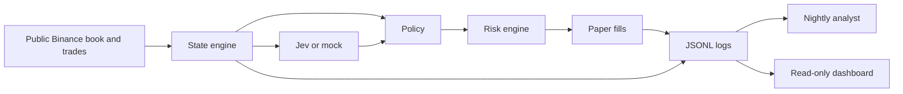
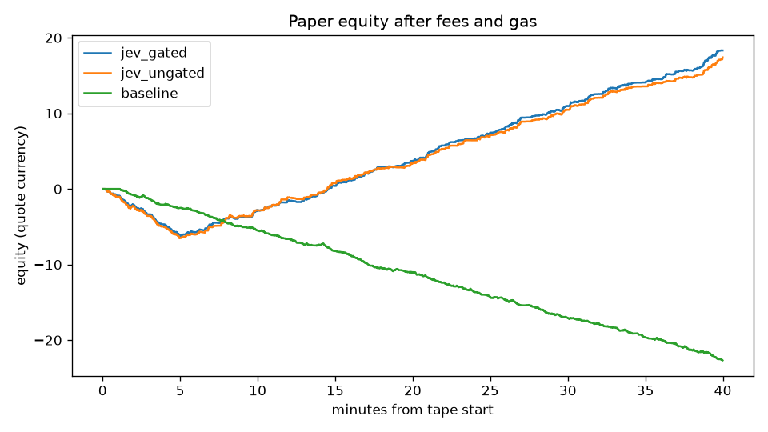
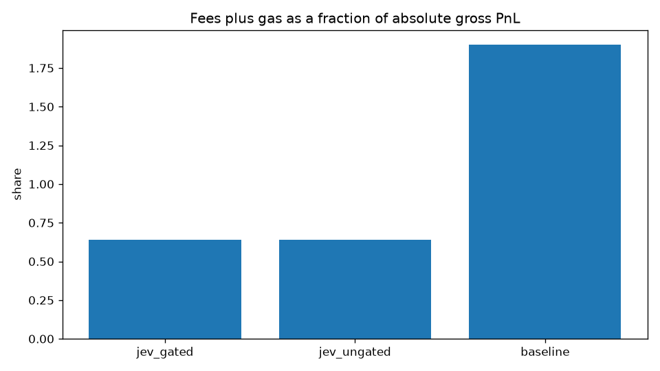
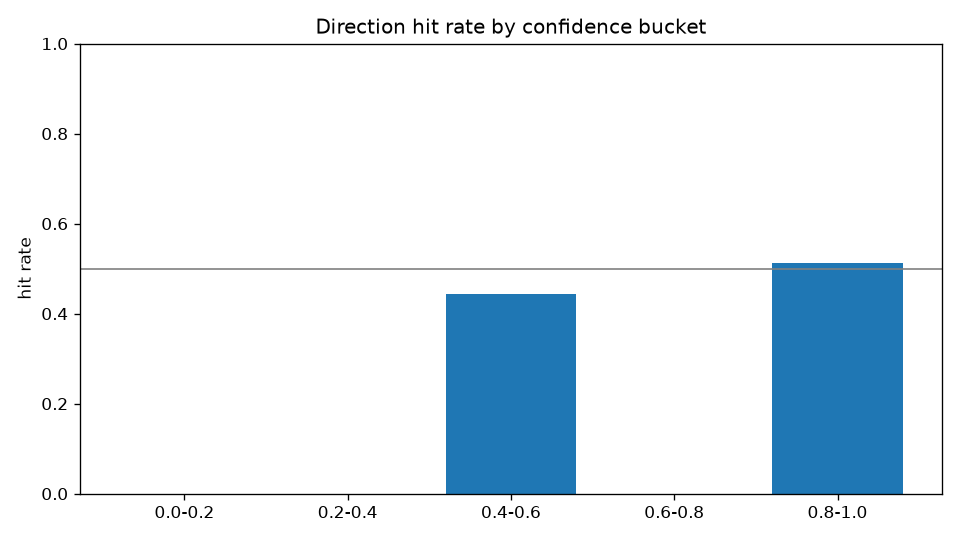
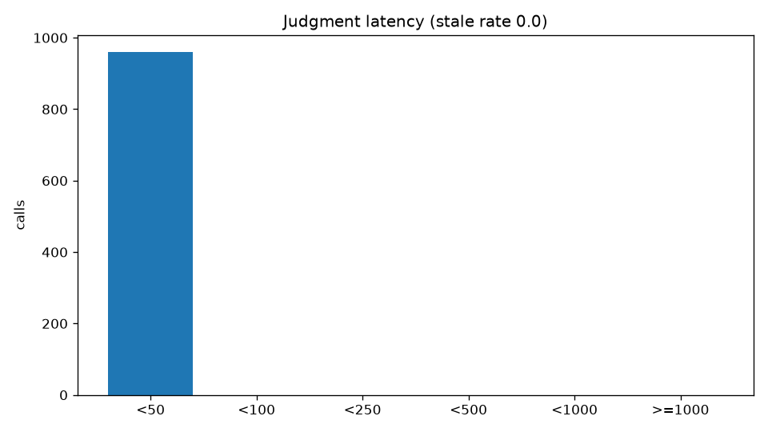

# Jev paper trader

A paper market maker for BTCUSDT. Code builds the state, Jev (or a mock) answers six narrow questions, code picks the action, and a risk engine can veto it. Nothing in this repo places a live order, holds a private key, or moves funds.

The paper run itself needs about two weeks of data. **Record raw Binance data first** (`make record`). Do not leave `make live` running on the mock: those strategy logs are not the dataset. The charts below are a 40-minute synthetic replay through the same code, not those 9–10 days.

## What is running today

| Piece | State |
| --- | --- |
| Public book feed, state engine, policy, Avellaneda pricing, risk, paper fills | Built and tested |
| Three parallel strategies: `jev_gated`, `jev_ungated`, `baseline` | Built. They share snapshots, fees, and limits |
| Jev client | Interface is real. Default is `MockClient` until `TYPESAFE_API_KEY` exists |
| Health check and Telegram alerts | Built. Telegram sends only when both env vars are set |
| Nightly analyst | Built. Writes `reports/` and `proposals/`. Does not edit `config.yaml` |
| Read-only dashboard | Built |
| Record-only raw tape (`make record`) | Built. Writes `data/raw/YYYY-MM-DD.jsonl.gz` |
| Two-week paper run with live Jev | Not started. Leave `jev.client: mock` until TypeSafe credits are on the account |
| 9–10 day results, demo video, LinkedIn post, resume numbers | Not done. Do not invent them |

Leave `jev.client: mock` until TypeSafe credits (or a Discord grant) are actually on the account. Set a spend cap before switching `client` to `jev`, and keep `call_every_n_blocks: 5`.

## Architecture



The hot path is one block, default one second:

1. The state engine writes a numeric snapshot from data at or before the block time.
2. On every 5th block the Jev strategies ask one question battery. The baseline never calls Jev.
3. If the answer arrives at or after the next block, it is stale and the strategy holds its resting quotes.
4. If the call fails, that block uses code-only rules.
5. The policy maps the judgment through thresholds in `config.yaml`.
6. Risk can pull quotes, force a one-sided reduce, or flatten and halt.
7. The simulator fills a quote only when a later trade prints through it. On Binance spot it charges Regular User maker/taker (0.100% / 0.100%) **on fills only**. Place and cancel are free. There is **no gas** on a CEX. An earlier revision wrongly charged $0.01 gas on every place, cancel, and fill; that is why the first sample baseline "died." Gas remains a config flag for a future on-chain venue.

Jev is not in the hot path as a writer. It does not see the order, and it is not asked to do arithmetic. The prompts in `decision/jev_client.py` are qualitative. Cutoffs such as `toxic_flow_pull: 0.72` live in `config.yaml`. The nightly analyst can propose a diff under `proposals/`. It never writes `config.yaml`. The dashboard has no POST route that can change a quote.

Claude, when `ANTHROPIC_API_KEY` is set, only writes the nightly markdown. With no key, the same job fills the report from the metrics directly. The header of each report says which path ran.

## Sample replay, not a track record

`make sample` builds a 40-minute random-walk tape (seed 7), replays it, and writes the figures. The mock answers are a function of the block number. They do not read the book. About 15% of the prints are planted 30 bps through the mid so that quotes can fill. There is no queue position: a trade through the quote fills us. `vol_vs_24h` is empty because the tape is shorter than a day.

Do not quote these numbers as trading performance. They use Binance Regular User spot fees (10 bps maker and taker on fills, no BNB discount, no gas).

| Strategy | Net after costs | Fees | Gas | Fills | What happened |
| --- | ---: | ---: | ---: | ---: | --- |
| jev_gated | +18.33 | 32.65 | 0 | 220 | Finished the tape |
| jev_ungated | +17.41 | 31.16 | 0 | 211 | Finished the tape |
| baseline | −22.68 | 47.86 | 0 | 349 | Finished the tape |

Gas is zero for all three. The baseline no longer hits the $25 daily-loss kill; that halt in the first sample was almost entirely fake CEX gas. Fees now dominate, which is the story you would tell in an interview: on Binance you pay when you trade, not when you requote. The two Jev arms still look similar because the mock is usually confident. Direction hit rate on the mock was coin-flip. Stale rate was 0% because the mock's latency is 1 ms.

The analyst's proposal for this tape, which was not applied, widens `min_half_spread_bps` from 2 to 3 and `baseline_half_spread_bps` from 6 to 8. See `proposals/sample.diff`.









## How to run

```bash
python3 -m venv .venv
.venv/bin/pip install -e ".[dev]"
# optional, only after a TypeSafe key and a spend cap:
# .venv/bin/pip install -e ".[dev,jev,agent]"
make test
make record          # public book + trades only → data/raw/
python scripts/check_data.py
make replay          # short fixture; point --tape at data/raw for a real day
make sample          # 40-minute synthetic tape, charts, post-mortem
make dashboard       # http://127.0.0.1:8081  read only
```

Record-only is the thing to leave running on a laptop that does not sleep. Live strategy logs with a mock Jev are not the dataset:

```bash
make record          # data/raw/YYYY-MM-DD.jsonl.gz, gaps in data/gaps.jsonl
# make live          # paper strategies. Do not start this until Jev credits exist.
```

Copy `.env.example` to `.env` if you want Telegram (`TELEGRAM_BOT_TOKEN`, `TELEGRAM_CHAT_ID`) or a real Jev key (`TYPESAFE_API_KEY`). Then set `jev.client: jev` in `config.yaml`. The model pin is `jev-1.14.0`. The SDK shape is in `docs/jev_reference.md` because the TypeSafe skill is a Claude Code plugin and is not loaded in Cursor.

Nightly post-mortem:

```bash
.venv/bin/python -m jev_paper.agent.analyst \
  --day 2026-10-30 --log-dir logs/live --config config.yaml
```

Docker, on a host you control. This was not deployed from here:

```bash
docker compose up -d
```

The bot service is `restart: always` and exposes `GET /health` on port 8080. The dashboard is port 8081 and mounts the logs read-only.

## Layout

- `src/jev_paper/data/feed.py` — Binance public depth and trades, reconnect, REST fallback, gzip JSONL replay
- `src/jev_paper/data/record.py` — record-only writer, gap log, per-minute heartbeat
- `scripts/replay.py` — run all three strategies on a recording or a fixture
- `scripts/check_data.py` — per-day counts, gaps, hours, disk size
- `src/jev_paper/state/engine.py` — snapshot from the past only
- `src/jev_paper/decision/jev_client.py` — `DecisionClient`, `JevClient`, `MockClient`
- `src/jev_paper/policy/engine.py` — action from thresholds
- `src/jev_paper/pricing/avellaneda.py` — reservation price and spread, plus the fixed baseline
- `src/jev_paper/risk/engine.py` — hard limits
- `src/jev_paper/sim/fills.py` — paper fills, fees, gas
- `src/jev_paper/loop.py` — stale hold, Jev-down fallback, flatten
- `src/jev_paper/agent/analyst.py` — LangGraph when installed, otherwise the same three steps in order
- `src/jev_paper/dashboard/app.py` — FastAPI, GET only
- `notebooks/analysis.ipynb` — same metrics as the charts

Logs, one JSON object per line: `snapshots.jsonl`, `decisions.jsonl`, `outcomes.jsonl`, `outcomes_<strategy>.jsonl`, `alerts.jsonl`.

## Limits worth knowing before a two-week run

- One market, BTCUSDT, top of book from Binance's public stream. The fill model is not Binance's matching engine.
- Binance spot Regular User fees are 0.100% / 0.100% (https://www.binance.com/en/fee/trading). Cancels are free. An earlier version of this repo charged gas on every place and cancel as if this were an on-chain book; that cost model is wrong for this venue and was removed.
- A position that merely marks a few dollars through `max_position_usd` stops adding and keeps the reducing side. A position past the cap by a full `max_order_usd` flattens and halts.
- Decisions are valid for the block they were requested in. Between calls the Jev strategies hold resting quotes. They do not reuse an old judgment.
- State keeps roughly 24 hours of tape and then drops older events. `vol_vs_24h` appears only after a day of past data.
- No demo video and no LinkedIn post. A post that cites the table above as a live result would be wrong. After 9–10 days of `logs/live`, the honest post is the three net numbers, the fee share, the stale rate, and the fact that it was paper.

## Tests

`make test` covers the feed parser and reconnect, a no-lookahead snapshot, the token budget of a snapshot, mock versus stale Jev answers, policy thresholds, Avellaneda inventory skew, risk vetoes, fill-through and gas, the three-strategy replay, the analyst leaving `config.yaml` untouched, a read-only dashboard, and a source scan that rejects order endpoints.
