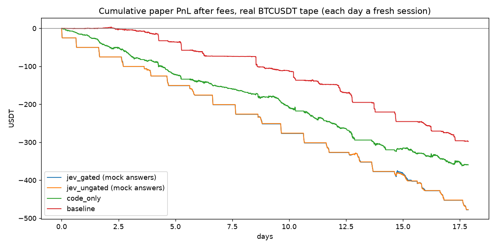
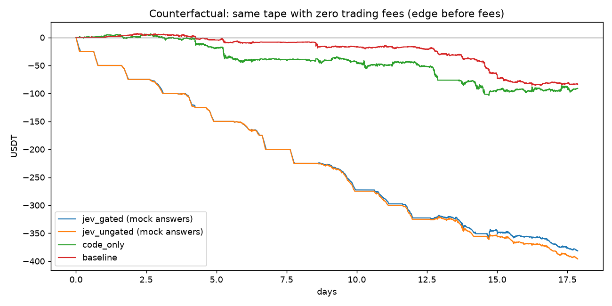
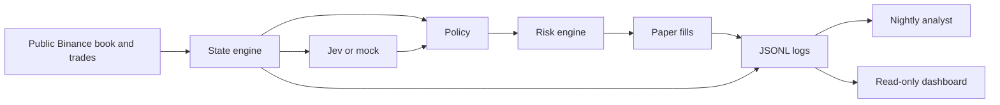

# jev-paper-trader

A paper market maker for Binance **BTCUSDT** spot, built so that a decision model can sit in one slot and be measured against plain code on the same tape.

Code builds the market state. A decision model (TypeSafe's **Jev**, or a stand-in) answers six narrow, typed questions. Code turns the answers into quotes. A risk engine can veto anything. Nothing in this repo places a live order, holds a private key, or touches an order endpoint, and a test enforces that.

[](LICENSE)

## Results on 18 days of real Binance data

I recorded the public BTCUSDT order book (top 20 levels, 100 ms) and every trade from **31 Oct to 18 Nov 2026**: 82.6M events, 429 hours of tape. Then I replayed it through four strategies. Each UTC day is a fresh session with a $25 daily-loss kill, a $40 drawdown kill and a $500 position cap.

| Arm | Decides with | Prices with |
| --- | --- | --- |
| `baseline` | nothing (always quote) | fixed 6 bps half-spread, inventory skew |
| `code_only` | code book rules (vol, spread, imbalance) | Avellaneda–Stoikov |
| `jev_gated` | model answers, gated on confidence | Avellaneda–Stoikov |
| `jev_ungated` | model answers, always acted on | Avellaneda–Stoikov |

**The Jev arms here ran on `MockClient`, not on Jev.** The mock's answers are a fixed function of the block number and ignore the market, so those two arms measure what an uninformed model costs you. They do not measure Jev. The plug-in point for a real model is described [below](#plugging-in-a-model).

### At Binance Regular-User fees (10 bps maker and taker)

| Arm | Net after fees | Before fees | Fees paid | Fills | Green days | Days the kill switch fired | Mean hours to kill |
| --- | ---: | ---: | ---: | ---: | ---: | ---: | ---: |
| `baseline` | **−297.74** | −42.45 | 255.29 | 10,630 | 1 / 19 | 9 | 12.3 |
| `code_only` | **−359.71** | −63.76 | 295.94 | 13,243 | 1 / 19 | 8 | 17.3 |
| `jev_gated` (mock) | −478.09 | −45.03 | 433.06 | 14,020 | 0 / 19 | 19 | 4.1 |
| `jev_ungated` (mock) | −477.44 | −55.63 | 421.80 | 13,558 | 0 / 19 | 19 | 4.1 |



### Same tape, fees set to zero (counterfactual)

This isolates edge before fees. It is not a real fee tier.

| Arm | Net | Fills | Green days | Days the kill switch fired |
| --- | ---: | ---: | ---: | ---: |
| `baseline` | −83.40 | 23,121 | 5 / 19 | 1 |
| `code_only` | −91.31 | 14,598 | 9 / 19 | 3 |
| `jev_gated` (mock) | −381.70 | 73,017 | 0 / 19 | 13 |
| `jev_ungated` (mock) | −395.98 | 75,244 | 0 / 19 | 14 |



### What the numbers say

1. **Fees decide the outcome.** At 10 bps a side, fees are 82–91% of each arm's loss. BTCUSDT's quoted spread sat at one tick, about 0.0013 bps, for most of the tape, so a retail-tier market maker pays thousands of times more per fill than the spread it can capture. Cancels are free on Binance, so the cost is in trading, not requoting.
2. **There is no edge before fees either, even with a generous fill model.** With fees removed, the code-only arm is green on 9 of 19 days and still finishes slightly negative. The quotes that fill are mostly the ones the market is about to move through: adverse selection.
3. **A bad model is worse than no model.** The uninformed mock hits the daily kill every day, after about 4 hours on average (fastest: 34 minutes). With fees off it fills 3–5× more often than the code arms and loses 4–5× more. Any model in this slot has to beat `code_only` and the plain baseline, not zero.
4. **The risk engine did its job.** No arm lost more than about $26.7 on any day, against a $25 limit plus one block of slippage.

Per-day numbers: [`reports/realtape/results.md`](reports/realtape/results.md), [`reports/realtape-zerofee/results.md`](reports/realtape-zerofee/results.md). Machine-readable: `results.json` in the same folders.

### How far to trust this

- **Fill model.** A resting quote fills when a later aggressive trade prints at or through its price, up to that trade's size. There is no queue position: we are treated as first in line at our price. That is *optimistic* about fill count, so real results would likely be worse, not better. A queue model is the most useful contribution anyone could make here (see [CONTRIBUTING](CONTRIBUTING.md)).
- **Top of book only for state.** The engine keeps five levels per side. No order-flow features beyond trade imbalance.
- **Per-day sessions.** State restarts at 00:00 UTC, so the first minute of each day is warm-up and the 24h volatility feature is never full. 31 Oct and 18 Nov are partial days. Nov 9 has a short gap from a recorder restart, and two NUL-padded lines from that restart are skipped.
- **One venue, one pair, one fee tier, 18 days.** Not a statement about market making in general.

## Plugging in a model

Any class with the `DecisionClient` shape in [`decision/jev_client.py`](src/jev_paper/decision/jev_client.py) can sit in the slot:

```python
class DecisionClient(Protocol):
    model_version: str
    def judge(self, snapshot: Snapshot, *, deadline_ms: int, clock: Clock) -> Judgment: ...
```

A `Judgment` carries six answers: market regime, direction with confidence, toxic-flow score, liquidity stress, quote environment, inventory pressure. The policy maps them to quote, widen, skew, pull or stand down through thresholds in `config.yaml`. The model never sees an order and is never asked for a price.

`JevClient` calls TypeSafe's Jev (pinned to `jev-1.14.0`; SDK notes in [`docs/jev_reference.md`](docs/jev_reference.md)). Set `jev.client: jev` and `TYPESAFE_API_KEY` to use it, and set a spend cap on the account first. A judgment that arrives after the block deadline is stale, and the strategy holds instead of acting on it.

## Architecture



Each block (one second by default):

1. The state engine builds a numeric snapshot from data at or before the block time. No lookahead; there is a test for it.
2. Every 5th block the model arms ask one question battery. `code_only` and `baseline` never call a model.
3. A late answer is stale and the strategy holds its resting quotes. A failed call falls back to code rules.
4. The policy maps the answer to an action through `config.yaml` thresholds.
5. Risk can pull quotes, force a one-sided reduce, or flatten and halt for the day.
6. The simulator fills quotes against later trades and charges maker/taker fees on fills only.

A nightly analyst writes a report to `reports/` and can propose a config diff under `proposals/`. It never edits `config.yaml`. The dashboard is read-only.

## Reproduce

```bash
python3 -m venv .venv
.venv/bin/pip install -e ".[dev]"
make test

# 1. record public data (book + trades, no keys) -> data/raw/YYYY-MM-DD.jsonl.gz
make record

# 2. replay every day as its own session, in parallel
PYTHONPATH=src .venv/bin/python scripts/replay.py --per-day --workers 7 --tape data/raw --log-dir logs/realtape

# 3. tables and chart
PYTHONPATH=src .venv/bin/python scripts/summarize_replay.py --log-dir logs/realtape --out-dir reports/realtape

# fee-free counterfactual
PYTHONPATH=src .venv/bin/python scripts/replay.py --per-day --workers 7 --config config.zero-fee.yaml --tape data/raw --log-dir logs/realtape-zerofee
```

The raw tape is about 700 MB gzipped and is not in the repo. Replay costs roughly 70 CPU-seconds per tape-hour and writes about 0.5 GB of logs per day.

Other targets: `make sample` (40-minute synthetic tape, quick smoke test), `make dashboard` (read-only, port 8081), `make check-data` (per-day counts and gaps). `docker compose up -d` runs the bot with `/health` on 8080.

Optional integrations, all off by default: Telegram alerts (`TELEGRAM_BOT_TOKEN`, `TELEGRAM_CHAT_ID`), a real Jev key (`TYPESAFE_API_KEY`), and an LLM-written nightly report. See `.env.example`.

## Layout

- `src/jev_paper/data/` — Binance public feed with reconnect and REST fallback, record-only writer, streaming replay reader
- `src/jev_paper/state/engine.py` — snapshot from the past only
- `src/jev_paper/decision/jev_client.py` — `DecisionClient`, `JevClient`, `MockClient`
- `src/jev_paper/policy/engine.py` — answers to actions; also the code-only rules
- `src/jev_paper/pricing/avellaneda.py` — reservation price and spread, plus the fixed baseline
- `src/jev_paper/risk/engine.py` — hard limits
- `src/jev_paper/sim/fills.py` — paper fills and fees
- `src/jev_paper/loop.py` — the block loop for replay and live
- `src/jev_paper/strategies.py` — the four arms
- `scripts/replay.py`, `scripts/summarize_replay.py`, `scripts/check_data.py`
- `src/jev_paper/agent/analyst.py`, `src/jev_paper/dashboard/app.py`, `notebooks/analysis.ipynb`

## Tests

`make test` covers the feed parser and reconnect, no-lookahead snapshots, mock versus stale answers, policy thresholds, Avellaneda inventory skew, risk vetoes, fills and fees, streamed versus in-memory replay, torn-line recovery, the analyst leaving `config.yaml` untouched, a read-only dashboard, and a source scan that rejects order endpoints.

## License

MIT. See [LICENSE](LICENSE). Contributions welcome; see [CONTRIBUTING.md](CONTRIBUTING.md).

<details>
<summary>Per-day net PnL at 10 bps fees</summary>

| Day | jev_gated | jev_ungated | code_only | baseline |
| --- | ---: | ---: | ---: | ---: |
| 2026-10-31 | -25.06 (halt) | -25.08 (halt) | -10.77 | -0.46 |
| 2026-11-01 | -25.03 (halt) | -25.08 (halt) | -22.24 | +0.72 |
| 2026-11-02 | -25.14 (halt) | -25.11 (halt) | -23.01 | -3.00 |
| 2026-11-03 | -25.14 (halt) | -25.03 (halt) | -26.09 (halt) | -4.52 |
| 2026-11-04 | -25.26 (halt) | -25.06 (halt) | -26.38 (halt) | -25.37 (halt) |
| 2026-11-05 | -25.37 (halt) | -25.09 (halt) | -25.42 (halt) | -25.11 (halt) |
| 2026-11-06 | -25.16 (halt) | -25.20 (halt) | -15.93 | -15.62 |
| 2026-11-07 | -25.10 (halt) | -25.12 (halt) | -10.60 | -0.58 |
| 2026-11-08 | -25.24 (halt) | -25.03 (halt) | -13.59 | -26.72 (halt) |
| 2026-11-09 | -25.28 (halt) | -25.02 (halt) | -17.97 | -10.77 |
| 2026-11-10 | -25.19 (halt) | -25.23 (halt) | -25.71 (halt) | -25.26 (halt) |
| 2026-11-11 | -25.09 (halt) | -25.27 (halt) | -25.61 (halt) | -10.93 |
| 2026-11-12 | -25.18 (halt) | -25.26 (halt) | -25.29 (halt) | -21.27 |
| 2026-11-13 | -25.28 (halt) | -25.19 (halt) | -25.62 (halt) | -26.19 (halt) |
| 2026-11-14 | -25.02 (halt) | -25.11 (halt) | -25.69 (halt) | -25.34 (halt) |
| 2026-11-15 | -25.27 (halt) | -25.04 (halt) | -8.92 | -25.06 (halt) |
| 2026-11-16 | -25.07 (halt) | -25.30 (halt) | -13.24 | -25.19 (halt) |
| 2026-11-17 | -25.12 (halt) | -25.12 (halt) | -18.46 | -25.46 (halt) |
| 2026-11-18 | -25.10 (halt) | -25.09 (halt) | +0.84 | -1.61 |

</details>
